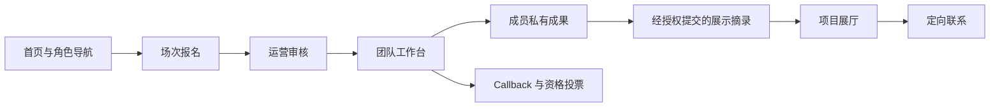

# 站点结构与协作契约

## 信息架构

| Figma 节点 | 当前站点入口 | 负责的对象 |
|---|---|---|
| 首页 1:5071、资料表 1:3151 | home、hub、cohorts | 参与路径、场次、席位、报名决定 |
| 人物 1:215、1:665、1:872，聊天 1:3 | people、teamspace | 自报档案、联系许可、联系申请与回复 |
| 项目 1:1041、社区 1:5829 | projects、teamspace、community、women | 私有证据、可展示摘录、反馈与组队 |
| 学校 1:6395、视频 1:1338、列表 1:1751 | school | 课程、练习、个人进度 |
| 资源 1:5576、联系 1:6222 | opportunities、helpdesk | 资源、收藏、纠错、复核 |
| 快闪新流程 | operations、decisions | 场次与审核、资格快照、投票与结算 |

## 数据流

项目采用 React/Vinext、Cloudflare Worker、D1 与 Drizzle。网站源码根目录中，app/club.tsx 负责 hash 路由与入口，app/platform.tsx 负责已登录的活动与协作，app/platform-content.ts 储存初始课程和来源。app/api/records/route.ts 处理私人草稿。app/api/platform/route.ts 校验身份、角色、状态、输入与写入。db/schema.ts 和 drizzle/ 定义资料结构及迁移历史。

records 按账号隔离。platform_items 以 kind、owner、parent、status、payload 表示场次与申请、项目与证据、展品与授权、联系人与请求。platform_votes 固定一次参与者投票。浏览角色不授予运营或团队权限。写操作同源，读取绕开共享缓存，外链只接收 HTTPS。新增字段对旧记录可缺省；审核、票数和席位的业务约束在服务端执行。

## 协作与发布

从本库 main 建功能分支。PR 指出服务哪一行角色、用户在哪一页完成什么动作、涉及哪些数据、如何兼容既有记录。涉及报名、投票、公开范围或分账时先修改说明，再改实现。将真实资料、凭据、会员邮箱、微信档案和付款资料留在获准使用的系统内。

本库与线上发布有各自的版本记录。将审查通过的实现应用到对应 Sites 源码，运行 TypeScript 检查、构建、实机浏览器流程，随后发布到已有私密站点，并记录两处提交和验证范围。遇到失败先确认当前线上版本，不写入真实会员数据作测试。

验收覆盖桌面和 390 像素手机、键盘焦点、无场次、无搜索结果、重复申请、会员自报缺失、旧场次、旁听容量、团队内外可见性、审核拒绝和投票回避。已发布、已验证、计划三种状态分开记录。
